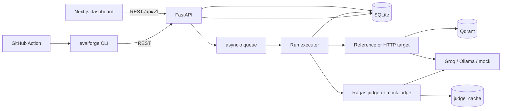
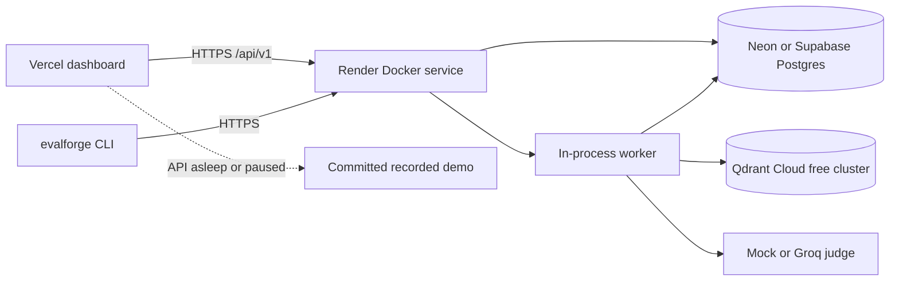

# EvalForge Architecture

EvalForge is a self-hosted RAG evaluation harness. It turns a golden dataset, a RAG target, a
judge configuration, and a set of latency measurements into an immutable run that can be inspected
and compared release over release.

This document describes the implementation in this repository. It intentionally states the
limits of the system alongside the design, because a benchmark that hides its uncertainty is worse
than no benchmark.

## 1. Design goals and invariants

Goals:

1. Make comparisons reproducible enough to act on.
2. Keep the target integration contract small: one POST and a JSON response.
3. Treat an LLM judge as a noisy, expensive dependency rather than truth.
4. Separate measured latency from target-reported claims.
5. Keep every aggregate auditable from per-query evidence.
6. Make the CI path deterministic and cheap through a mock judge.
7. Show when evidence is missing instead of turning missing data into zero.

Invariants:

- A dataset version and run configuration are immutable after creation.
- A run references a dataset version, never a mutable "latest" dataset.
- Failed queries and failed judgments are persisted explicitly.
- Aggregate means exclude missing judgments and report coverage.
- Hallucination rate is derived from faithfulness at read time.
- TTFT is stored with provenance: `measured`, `target_reported`, or `demo`.
- Provider secrets are never stored in configuration JSON. Optional target headers are persisted
  with the run so the worker can authenticate later, but header values are masked in API responses.
- The API computes a canonical configuration hash before the run is queued.
- One process owns the queue and the metadata writer in v1.

## 2. System topology



The worker is a background task in the API process. This is deliberate: it removes Redis/Celery
from the critical path, keeps progress and run history in one database, and makes the system easy
to run end to end. The cost is that the API must run as a single process and a process crash
interrupts in-flight work.

The hosted free-tier topology keeps the same process model but replaces local dependencies with
managed free services:



The Render container is stateless: Postgres owns metadata and run history, and Qdrant Cloud owns
the reference vectors. Render's ephemeral disk only holds container-local scratch. The browser
reaches Render directly, so CORS is locked to the Vercel origin.

## 3. Component boundaries

| Component | Responsibility | Does not do |
| --- | --- | --- |
| `app/api` | Validate HTTP input, expose resources, enforce write access | Run evaluations or compute metrics |
| `app/services` | Dataset/run orchestration, aggregates, comparisons, demo seed | Know HTTP transport details |
| `app/adapters` | Call JSON/SSE RAG targets and time responses | Score quality |
| `app/providers` | Stream Groq/Ollama/mock completions with usage | Know datasets or runs |
| `app/evaluators` | Normalize Ragas/mock judgments and implement the cache | Mutate run lifecycle |
| `app/reference` | Synthetic corpus, hash embedding, Qdrant index, startup bootstrap, reference RAG | Handle external targets |
| `app/workers` | Consume the queue, execute items, persist progress | Render API responses |
| `app/storage` | SQLAlchemy engine, sessions, models | Call external services |
| `app/schemas` | Pydantic API/domain contracts | Store data |

The dependency direction is `api -> services -> adapters/providers/evaluators/storage`. Providers
and evaluators do not import FastAPI. Storage does not import services.

## 4. Run lifecycle

```text
queued -> running -> succeeded
                  -> partial      (some target queries failed)
                  -> failed       (all target queries failed, or initialization failed)
                  -> cancelled    (cooperative cancel)
queued -> cancelled
```

An evaluation item is processed in this order:

1. Call the target with a bounded timeout.
2. Persist a `query_result` with answer, contexts, latency, token usage, and TTFT provenance.
3. Evaluate direct metrics with the configured evaluator.
4. Look up/write the judge cache for each metric and repeat.
5. Persist `metric_scores`, including failed rows.
6. Derive a `hallucination_rate` score row from the successful faithfulness samples.
7. Increment successful progress and commit.

A target failure creates a failed `query_result` and increments `failed_queries`; the worker
continues. A judge failure creates a failed `metric_score`; the query and run can still succeed,
but the metric coverage drops. The UI and API expose both kinds of failure separately.

Warm-up requests are issued and discarded before measured items. Cancellation is checked between
items; an in-flight item is allowed to finish. On API startup, queued runs are re-enqueued and
runs left `running` by the previous process are marked failed with an explicit interruption
message.

## 5. Persistence model

SQLAlchemy async is the metadata layer. Alembic owns the schema. Local work uses SQLite with WAL,
foreign keys, and a 5-second busy timeout. Deployment uses managed Postgres; the settings layer
normalizes `postgres://` and `postgresql://` to `postgresql+asyncpg://`, strips libpq-only query
parameters, and enables TLS with `EVALFORGE_DATABASE_SSL`. The same migrations run on both.

| Table | Purpose | Important constraints |
| --- | --- | --- |
| `datasets` | Logical dataset name | Unique name |
| `dataset_versions` | Immutable content snapshots | Unique `(dataset_id, version_number)` and `(dataset_id, content_hash)` |
| `dataset_items` | Ordered questions, ground truth, reference contexts | Unique `(dataset_version_id, ordinal)` |
| `runs` | Configuration snapshot, lifecycle, progress, provenance, optional `client_ip_hash` | Snapshot JSON is immutable; counts non-negative; indexed by `(client_ip_hash, created_at)` and `created_at` |
| `query_results` | One target call per dataset item | Unique `(run_id, dataset_item_id)`; TTFT provenance check |
| `metric_scores` | One judgment per item/metric/repeat | Unique `(query_result_id, metric_name, sample_index)` |
| `judge_cache` | Cross-run cache of successful judgments | Unique cache key; no foreign key to a run |

There is no aggregate table. Means, coverage, and percentiles are calculated from per-query rows on
read. At the target scale this is cheap and keeps evidence authoritative. An aggregate cache would
add invalidation risk without a measured need.

`target_config` is sanitized before API serialization: header values are replaced with a sorted
list of header names. The worker still needs those values to call an authenticated target, so the
database row remains sensitive and must be protected. Provider keys live in environment variables
or a secret manager and are never stored in a run row.

## 6. Dataset ingestion

Datasets enter through `POST /api/v1/datasets`. Each JSONL line must match:

```json
{
  "question": "A non-empty question",
  "ground_truth": "A non-empty reference answer",
  "reference_contexts": ["At least one non-blank passage"],
  "metadata": {"source": "optional object"}
}
```

Validation has these properties:

- unknown fields are rejected;
- the upload is capped by byte size and item count;
- invalid lines produce line-numbered errors;
- duplicate questions are counted in the validation summary;
- dataset content is canonicalized and SHA-256 hashed;
- re-importing identical content under the same name returns the existing version instead of
  creating a duplicate;
- changed content creates a new immutable version.

The golden `reference_contexts` are stored for inspection and offline diagnostics. They are **not**
injected as the target's retrieved contexts; the target must return its own retrieval for context
recall and faithfulness to mean anything.

## 7. Reference RAG

The bundled corpus contains 28 synthetic technical documents. The sample golden dataset contains
112 questions linked to that corpus by content, not by an external web crawl.

The reference pipeline uses:

- `HashEmbedding`, a deterministic 384-dimension feature-hashing embedding with bigram features;
- Qdrant for nearest-neighbor storage/search, using a local path or a Qdrant URL;
- cosine distance and a collection name pinned by settings;
- `top_k` between 1 and 20;
- an extractive mock answer for offline runs, or a streamed Groq/Ollama answer built from retrieved
  passages.

The hash embedding is lexical, not a trained semantic model. It exists so the complete reference
path works offline and deterministically. A real semantic embedding model can replace it behind
the same `build_reference_index` boundary, but scores from different embeddings are not comparable.

Evaluation runs against a target's returned contexts. The reference corpus is a fixed synthetic
fixture; it is not presented as a public benchmark.

## 8. Target contract

The mandatory contract is:

```http
POST /query
Content-Type: application/json

{"question": "..."}
```

A JSON response contains required `answer`, optional `contexts`, optional `ttft_ms`, and optional
`input_tokens` / `output_tokens`. The adapter records wall-clock latency around the call. A target
TTFT larger than measured latency plus a small scheduling margin is rejected.

Streaming targets use `Accept: text/event-stream`. Each `data:` event is JSON. Supported event
shapes include `{"contexts": [...]}`, `{"delta": "..."}` (also `token`), token counts, and
`{"error": "..."}`. The adapter measures TTFT at the first non-whitespace delta. Every event must
be valid JSON; the stream ends when the response closes.

TTFT provenance is intentionally conservative:

- `measured`: EvalForge observed the first streamed answer chunk.
- `target_reported`: the target supplied `ttft_ms`; it is useful but not independently verified.
- `demo`: a synthetic value in read-only demo mode.

A non-streaming target cannot expose a platform-measured TTFT. EvalForge leaves it null rather than
inferring it from total latency.

## 9. Quality evaluation

Direct metrics are `context_recall`, `faithfulness`, and `answer_relevance`. The LLM evaluator wraps
Ragas 0.4.3 collection metrics with an OpenAI-compatible client for Groq or Ollama. The deterministic
mock evaluator uses lexical support/overlap and hash-seeded jitter, with no network calls.

Aggregation is:

```text
query_metric_i = mean(normalized sample scores for metric m on query i)
run_metric_m   = mean(query_metric_i over queries with a valid judgment)
```

This is a macro average: each query contributes equally. Missing scores are excluded from the
denominator and surfaced as `judged_queries`, `total_samples`, and `failed_samples`.

Hallucination rate is not a separate judge. For each query with successful faithfulness samples:

```text
hallucination_i = 1 - mean(faithfulness samples_i)
hallucination_rate = mean(hallucination_i over valid queries)
```

It is an unsupported-claim proxy. It is not a calibrated probability of falsehood, does not test
against ground truth, and does not reward completeness.

## 10. Judge cache

Successful judge calls are cached in `judge_cache`. The cache key is SHA-256 over canonical JSON
containing evaluator name/version, prompt version, judge model, metric, sample index, question,
answer, contexts, and ground truth. Run ID and timestamps are excluded so identical evidence can be
reused across runs.

Cache hits copy the cached score into a new `metric_scores` row and set `judge_cached=true`. New
judgments create the cache entry and set it false. Failed judgments are never cached. The cache has
no TTL; operators must invalidate entries when a provider silently changes a model under the same
name or when a prompt changes without a prompt-version bump.

Cache entries can contain answer/context text in `reason` and `result`, so the cache inherits the
privacy classification of evaluated content. It must not be published or shared casually.

## 11. Latency and throughput

Latency aggregates use successful target calls only. Warm-ups, failed calls, queue wait, and judge
time are excluded. p50 and p95 use linear interpolation (Hyndman-Fan type 7):

```text
h = (n - 1) * p
interpolate between sorted[floor(h)] and sorted[ceil(h)]
```

The product reports p50 and p95 rather than p99 because the bundled datasets are small; p99 would
be unstable and easy to over-interpret.

TTFT is the time from immediately before the request to the first non-whitespace answer delta.
Token throughput is computed only when usage and TTFT exist and the generation window is positive:

```text
tokens_per_second = output_tokens / ((latency_ms - ttft_ms) / 1000)
```

Target-reported TTFT is kept separate so the dashboard cannot present it as platform-measured
precision.

## 12. Comparison

`GET /api/v1/runs/compare` returns the full summaries plus rows for:

- context recall, faithfulness, answer relevance, hallucination rate, and success rate;
- latency p50/p95;
- TTFT p50/p95;
- mean output tokens per second.

Deltas are `candidate - baseline`; relative deltas are included when the baseline is non-zero.
The dashboard labels quality changes in percentage points and latency changes in milliseconds.
Labels are heuristic, not significance tests.

The API is deliberately descriptive: it does not currently reject comparisons across different
dataset versions or judge configurations. The UI shows each run's configuration, and operators are
expected to compare like with like. A strict compatibility guard is a sensible next step, not a
hidden assumption in the current code.

## 13. API surface

All versioned routes are under `/api/v1`. The unauthenticated liveness route `/health` also exists at
the service root for Render and container checks.

| Method and path | Purpose | Write protected |
| --- | --- | --- |
| `GET /health` (service root) | Root liveness for Render and Docker health checks | No |
| `GET /api/v1/health` | Version and environment | No |
| `GET /api/v1/health/ready` | Database readiness, HTTP 503 when unavailable | No |
| `GET /api/v1/meta` | Demo/auth/provider capabilities and live-run policy | No |
| `GET /api/v1/datasets` | Dataset catalogue with latest version | No |
| `GET /api/v1/datasets/sample` | Download the bundled JSONL | No |
| `POST /api/v1/datasets` | Validate and import a dataset/version | Yes |
| `GET /api/v1/datasets/{id}` | Latest version and its items | No |
| `GET /api/v1/runs` | Filterable, paginated run list | No |
| `POST /api/v1/runs` | Create and enqueue a run; 429 when live limits pause | Yes |
| `GET /api/v1/runs/{id}` | Run summary and aggregates | No |
| `GET /api/v1/runs/{id}/status` | Lightweight progress polling | No |
| `GET /api/v1/runs/{id}/results` | Paginated per-query evidence | No |
| `POST /api/v1/runs/{id}/cancel` | Request cooperative cancellation | Yes |
| `GET /api/v1/runs/compare` | Compare two completed or in-progress runs | No |

The API returns Pydantic models directly. OpenAPI is generated at `/openapi.json`, and Swagger UI
is at `/docs`.

Write access is enabled when `EVALFORGE_WRITE_API_TOKEN` is non-empty. Requests must send
`X-API-Key` or `Authorization: Bearer ...`; comparison uses constant-time digest comparison. In
demo mode every write endpoint returns HTTP 403 even if a token is configured. CORS is restricted
to configured origins, and CORS is not treated as authentication.

## 14. Dashboard

The Next.js App Router supplies:

- `/` overview with run counts, latest quality/latency, recent runs, and dataset links;
- `/runs` status-filtered run history;
- `/runs/[id]` aggregate metrics, configuration, provenance, progress, and paginated query evidence;
- `/runs/new` dataset/provider/target/judge form with write-token handling;
- `/compare` baseline/candidate selectors and grouped deltas;
- `/datasets` and `/datasets/[id]` catalogue and immutable version inspection.

SWR handles fetch/cache/revalidation. Active runs poll status and refresh their summary. The token
is kept in `sessionStorage` and is never sent to the Next.js server. Responsive CSS switches to a
drawer navigation at narrow widths; E2E covers the mobile journey.

A backend gate runs before the shell renders. It probes `/api/v1/health` and the metadata endpoint;
if the backend is asleep it shows a waking screen, and after
`NEXT_PUBLIC_BACKEND_WAKE_TIMEOUT_MS` (20 seconds by default) it switches the whole app into
recorded mode. An unreachable API or a `live_runs_paused` 429 does the same. Recorded mode serves
`frontend/src/lib/recorded-demo.json` through a resolver that mirrors the read-only API shapes,
disables writes, and renders a permanent **Recorded** banner on every route. SWR keys include the
live/recorded scope so a retry refetches instead of showing cached data from the other mode.

## 15. Deployment

Local and container topology:

- Next.js web on port 3000;
- FastAPI on port 8000;
- Qdrant on 6333/6334;
- SQLite in a persistent volume;
- sample corpus and golden data baked into the backend image.

The backend image runs Alembic before Uvicorn, uses a non-root user, and exposes a healthcheck. The
web image uses Next.js standalone output. Compose passes the write token, demo flag, Qdrant URL,
Groq key, and Ollama host URL through environment variables.

The hosted free-tier topology is:

- Vercel serves the Next.js dashboard;
- one Render free Docker service runs the API and the in-process worker;
- Neon or Supabase hosts Postgres;
- Qdrant Cloud hosts the reference collection;
- `frontend/src/lib/recorded-demo.json` provides the offline fallback.

Render services sleep after inactivity, so the first request can take 30-60 seconds. The API is
stateless beyond Postgres and Qdrant; the container's ephemeral disk is not a data store. The
`render.yaml` blueprint sets `EVALFORGE_LIVE_RUN_PROTECTION=true`, a 10-query mini-suite, a
per-network limit of 3 runs per 60 minutes, a 20-run UTC daily cap, and a generated write token and
IP-hash salt. CORS accepts only the configured Vercel origin and rejects `*` in production.

Read-only demo deployments set `EVALFORGE_DEMO_MODE=true`. On an empty database the API seeds two
synthetic runs from the sample data, marks them `source=demo`, and blocks writes. No provider,
judge, or Qdrant call is needed to view the demo.

The recorded fallback is generated, not hand-written:

```powershell
Set-Location backend
.\.venv\Scripts\Activate.ps1
python -m scripts.export_recorded_demo
```

The exporter uses the real demo seed, metadata builder, dataset/run services, and comparison
service, then writes the JSON consumed by the dashboard. Regenerate and commit it when the seed or a
response schema changes. `DEPLOYMENT.md` has the click-by-click account and verification steps;
`DECISIONS.md` records why the deployment is shaped this way.

## 16. Failure handling

| Failure | Behavior |
| --- | --- |
| Invalid JSONL | Reject the import with line-numbered validation errors |
| Duplicate dataset content | Return the existing version with `created_version=false` |
| Target timeout/unreachable | Persist a failed query result, continue; `partial`/`failed` |
| Malformed target payload | Adapter error; failed query result; sanitized message |
| Judge outage | Persist failed metric samples; keep query progress; reduce coverage |
| Worker restart | Startup marks stale `running` runs failed and re-enqueues `queued` runs |
| Cancellation | Persist cancellation; stop before the next item; preserve written evidence |
| Missing TTFT | Null, not inferred from total latency |
| SQLite contention | WAL, foreign keys, busy timeout, one writer; single process required |
| Missing Groq key | Reject LLM-judge run creation with an actionable error |
| Render cold start | Dashboard shows waking state; recorded demo after the wake timeout |
| Live-run limit reached | HTTP 429 with `live_runs_paused`, reason, and `Retry-After`; recorded demo |
| Qdrant unavailable at startup | Log the failure, keep `/health` and reads up; reference runs retry and surface the error |

The CI gate is strict rather than statistical: threshold failures return exit code 1, a partial or
failed run returns 1, and an API/CLI error returns 2. Without explicit thresholds the CLI only
checks that the run did not fail at the target level. Judge coverage is displayed in the markdown
report and API, but is not a separate configurable threshold in v1.

## 17. Testing and verification

Local verification of this tree:

- 99 backend tests, 86.16% branch coverage, 80% coverage floor;
- Ruff lint and format checks clean;
- strict mypy clean for `app` and `tests`;
- Alembic migrations applied against SQLite; a CI Postgres service applies the same head and checks
  the `runs.client_ip_hash` column through asyncpg;
- 35 Vitest/React Testing Library tests;
- ESLint and TypeScript clean;
- Next.js production build successful;
- 4 Playwright tests: full dataset import/run/compare flow, mobile navigation, backend-off recorded
  fallback with a permanent banner, and immediate recorded mode from the waking screen;
- a full-history gitleaks job in CI;
- action shell path executed against the live API, producing a successful run, markdown report, and
  zero exit code.

The mock judge makes CI deterministic. No test calls a paid provider. Real Groq/Ollama paths have
unit coverage with fakes but were not exercised live because no key or local model was available.

Docker Compose was not executed in the authoring environment; Docker was unavailable. The Compose
file is validated in CI, and the Render Docker build is exercised during deployment. The GitHub
Action's PR-comment step requires a GitHub runner and repository permissions and was not exercised
locally.

## 18. Security and privacy

- A single shared write token is an access gate, not multi-user identity or authorization.
- The live-run limiter stores a salted SHA-256 of the caller's IP, never the raw address. The salt is
  a secret supplied through `EVALFORGE_LIVE_RUN_IP_HASH_SALT`, and rotating it breaks continuity with
  old hashes.
- CORS is restricted to explicit origins and wildcard origins are rejected in production. CORS is not
  authentication.
- Never expose an unauthenticated API that can spend provider credits or reach internal targets.
- User-supplied target URLs are not SSRF-filtered. A hosted deployment must block loopback,
  link-local, and private ranges unless explicitly allowlisted.
- Provider keys stay in environment variables. Target authorization headers must be persisted for
  deferred execution; API serialization strips their values, but the database itself must be
  treated as sensitive.
- Judge calls send questions, answers, and contexts to the configured judge provider. Use Ollama
  for sensitive corpora or accept the provider's data policy.
- Judge cache rows may contain sensitive source text.
- React escapes rendered content; untrusted answers are not rendered as raw HTML.
- The GitHub Action needs `contents: read` and `pull-requests: write` for PR comments and should use
  a least-privilege token.

## 19. Scaling path

The current design is for a single team and a single API process. At 10,000 queries the first
bottlenecks are judge cost and wall time, not metadata row size.

Reasonable next steps, in order:

1. Add a durable queue (ARQ/Celery with Redis or a cloud queue) and a separate worker deployment.
2. Move the live-run limiter from process-local locking to a database constraint or distributed
   lock before adding API replicas.
3. Add batch writes for metric samples and progress updates.
4. Add provider concurrency limits, retries with backoff, and per-run cost budgets.
5. Store large contexts/judge evidence in object storage if retention grows.
6. Add a strict comparison compatibility policy and paired bootstrap intervals for regressions.

Until then, running multiple Uvicorn workers would create multiple queues. That is a known
limitation, not an invitation to scale this deployment shape.

## 20. Deliberate limitations

- The bundled corpus, questions, and mock scores are synthetic; they do not benchmark a real
  product.
- The reference embedding is lexical and deterministic, not semantic.
- Reference index invalidation is count-based; a content change with an unchanged document count
  requires explicit collection deletion/re-indexing.
- Hallucination rate is a faithfulness complement, not a factuality model.
- Judge scores depend on the judge model and prompt; different judges are not directly comparable.
- The comparison endpoint does not reject mismatched dataset/judge configurations.
- Thresholds are strict and have no tolerance or confidence interval.
- Judge failures reduce metric coverage rather than changing the run's target-level status.
- The judge cache has no automatic expiry.
- There is no multi-user auth, SSRF guard, or provider budget enforcement. The public deployment
  relies on a shared write token and a coarse per-network/daily live-run cap, not on per-user
  identity or billing controls.
- The in-process queue and single API instance restrict the system to one instance. Production uses
  Postgres, but horizontal scaling still needs a durable queue.
- Render free services sleep, so cold-start latency is part of the product experience and the
  recorded fallback is a required path, not a nice-to-have.
- The recorded demo is a committed snapshot of synthetic data. It is never presented as live, and
  it does not prove anything about a real RAG system.
- p99 is intentionally omitted because the sample sizes are small.
- Docker/GitHub-live verification remains a deployment-environment task.

These limits are documented so an operator can decide whether EvalForge fits a given evaluation
program. They are also the backlog for turning a strong single-node harness into a multi-team
service.
