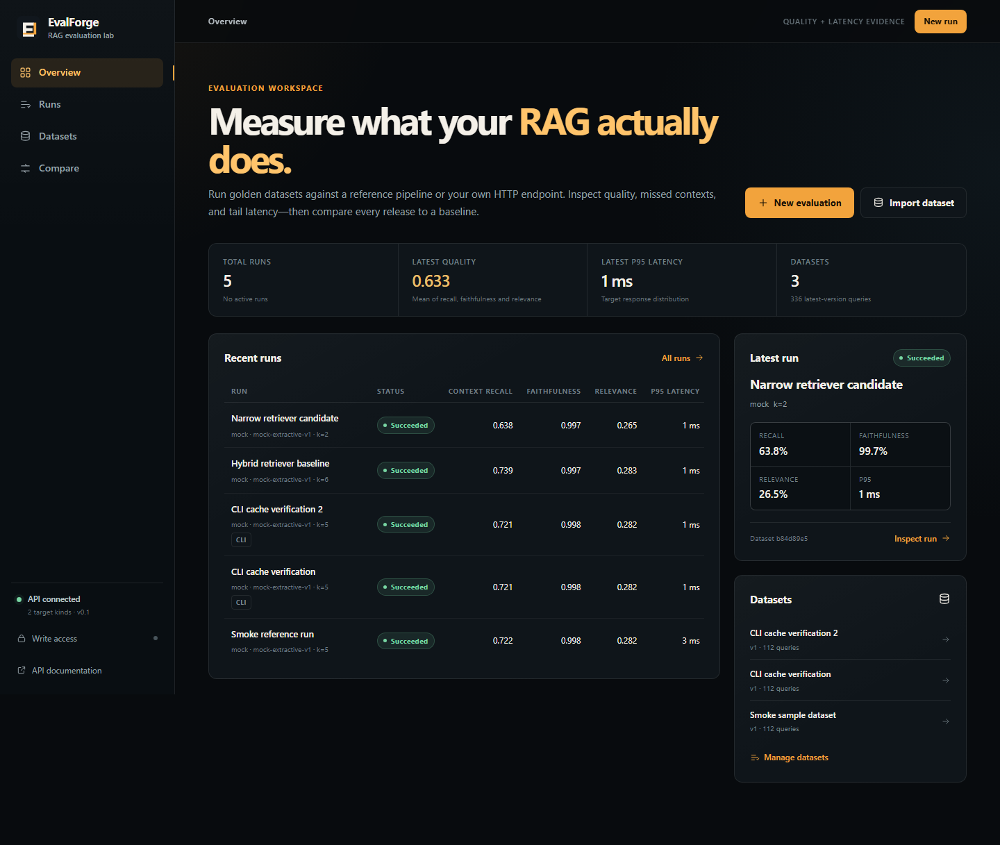
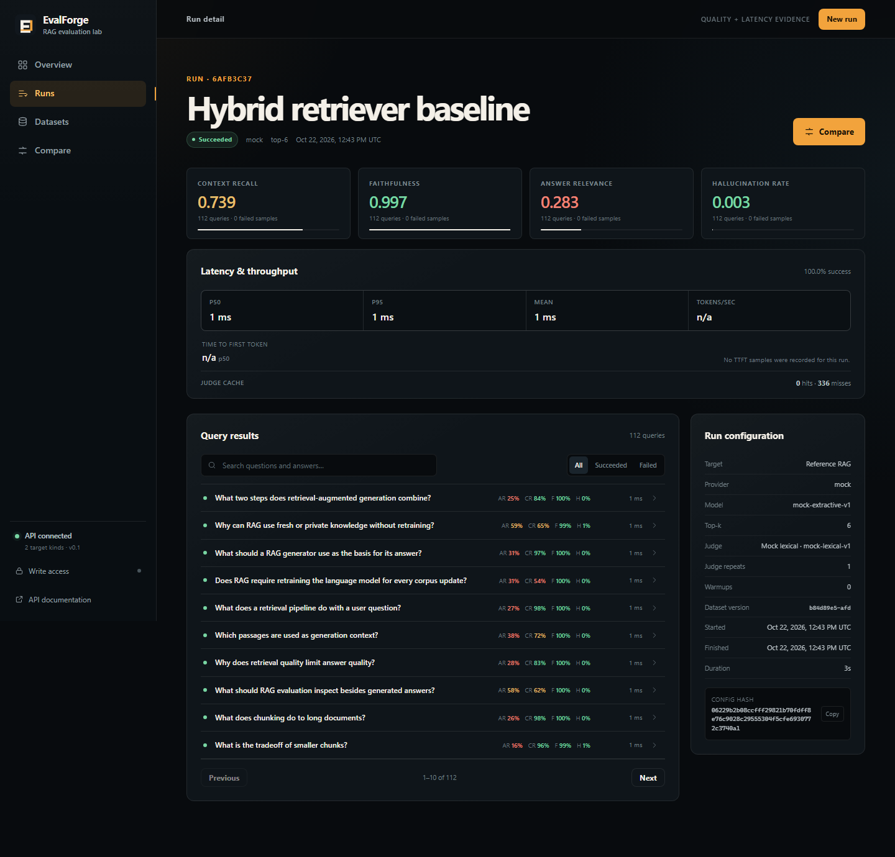
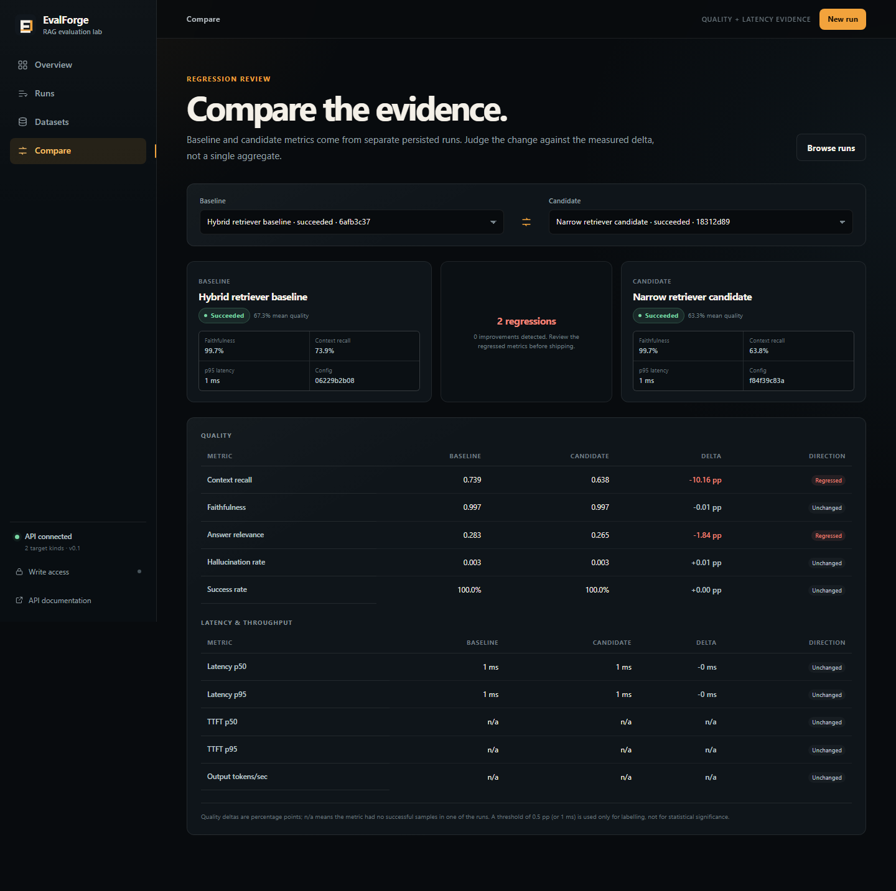
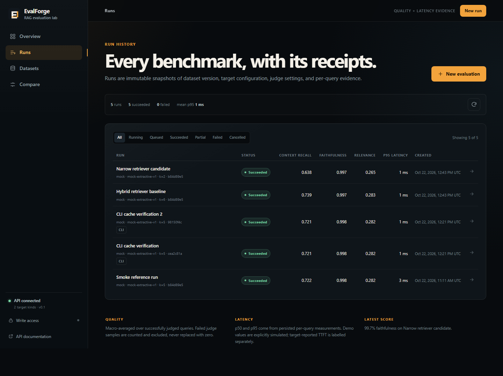
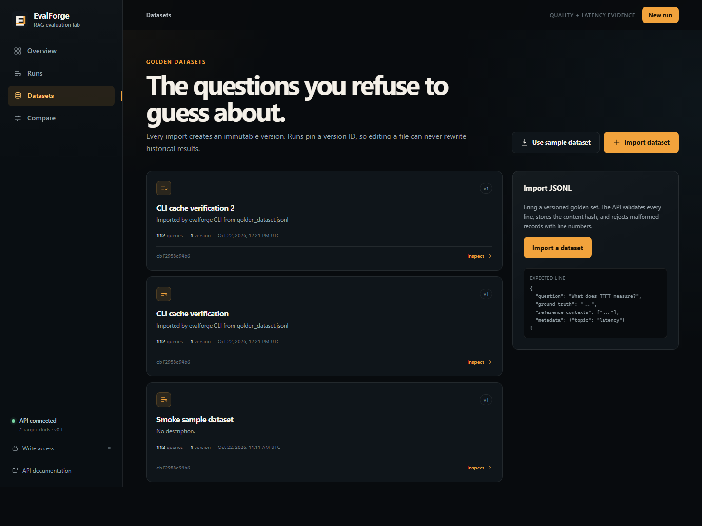
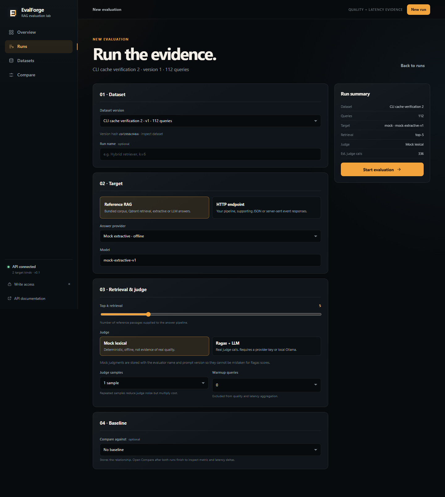
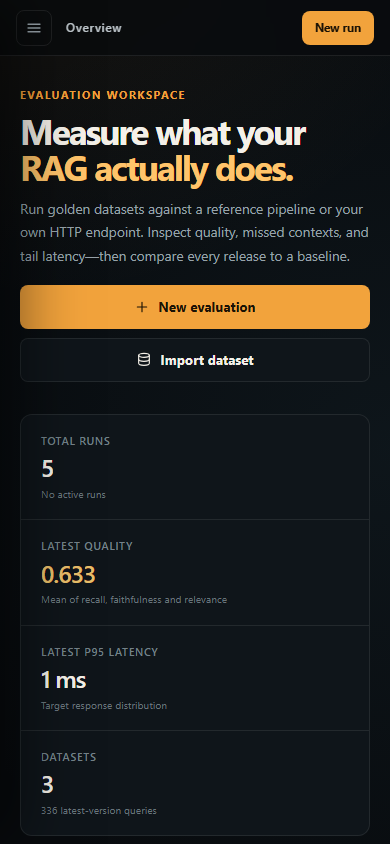

# EvalForge

EvalForge evaluates retrieval-augmented generation pipelines against versioned golden datasets. It
reports Ragas quality metrics, measured latency and TTFT provenance, per-query evidence, regression
deltas, and a CI gate that can block a pull request.

It is built as a complete, self-hosted system rather than a notebook: FastAPI API, Next.js
dashboard, SQLAlchemy/Alembic persistence, Qdrant reference retrieval, Groq/Ollama providers, an
LLM judge with caching, a standalone CLI, a composite GitHub Action, Playwright E2E tests, and a
read-only demo mode.

[Architecture](ARCHITECTURE.md) | [Core functions](CORE_FUNCTIONS.md) |
[Interview notes](INTERVIEW_PREP.md) | [GitHub Action](action/README.md) |
[API docs](http://localhost:8000/docs) after starting the API



## What it measures

- **Context recall** - whether claims in the reference answer are supported by the contexts the
  target actually retrieved.
- **Faithfulness** - whether claims in the generated answer are supported by those contexts.
- **Answer relevance** - whether the answer addresses the question.
- **Hallucination rate** - explicitly derived as `1 - faithfulness`, never presented as an
  independent classifier.
- **Latency p50/p95** - measured end-to-end target-call latency for successful calls.
- **TTFT p50/p95** - platform-measured for streaming targets, or stored as weaker
  `target_reported` evidence.
- **Token throughput** - only when output token usage and a positive generation window exist.
- **Success rate and judge coverage** - failed queries and failed judgments stay visible instead
  of being coerced to zero.

All quality aggregates are macro averages over queries. Missing judgments are excluded from the
denominator and reported through `judged_queries` and `failed_samples`.

The screenshots and bundled data use a deterministic **mock** judge. They demonstrate the product,
not the quality of any real RAG system.

## Features

- Immutable dataset versions with JSONL validation, content hashing, deduplication, and version
  history.
- Reference RAG over a bundled 28-document synthetic corpus and 112-question golden dataset.
- HTTP targets with JSON or SSE streaming, target headers, timeouts, and TTFT provenance.
- Ragas 0.4.3 metrics with a Groq or Ollama OpenAI-compatible judge.
- Deterministic lexical mock judge for tests, offline use, and CI.
- Cross-run judge cache keyed by evaluator, prompt, model, metric, repeat, question, answer,
  contexts, and ground truth.
- In-process async run worker with queued/running/succeeded/partial/failed/cancelled states,
  progress persistence, restart reconciliation, and cooperative cancellation.
- Side-by-side comparison of quality, latency, throughput, and success rate.
- Dashboard with run history, per-query evidence, dataset inspection, dark/light themes, and a
  responsive layout.
- CLI for datasets, runs, thresholds, markdown reports, and JSON automation.
- Composite GitHub Action that runs the CLI, enforces thresholds, uploads artifacts, and upserts a
  pull-request comment.
- Read-only demo mode seeded without provider calls.
- 85 backend tests, 22 frontend tests, 2 Playwright flows, an 80% backend coverage floor, and CI for
  lint, types, migrations, tests, builds, and E2E.

## Screenshots

| | |
| --- | --- |
|  |  |
|  |  |
|  |  |

## Stack

- **API:** Python 3.11+, FastAPI, Pydantic v2, SQLAlchemy 2 async, Alembic, SQLite (WAL).
- **Evaluation:** Ragas 0.4.3, LangChain 0.3, Groq/Ollama through an OpenAI-compatible client.
- **Retrieval:** Qdrant with a deterministic 384-dimension hash embedding for offline reference
  runs.
- **Web:** Next.js 15 App Router, React 19, TypeScript, SWR, custom CSS.
- **Verification:** pytest, Ruff, mypy, Vitest, React Testing Library, Playwright.
- **Delivery:** Docker Compose, GitHub Actions, composite action.

## Quickstart

### Prerequisites

- Python 3.11 or 3.12
- Node.js 20.9+ (Node 20.19+ or 22 is recommended; this repository was tested on 20.10)
- Docker Desktop only for the containerized stack

### 1. Configure

```powershell
Copy-Item .env.example .env
```

The defaults work locally. For any shared deployment, set a long random
`EVALFORGE_WRITE_API_TOKEN`; when it is non-empty, every write endpoint requires `X-API-Key` or a
Bearer token. An empty value disables write authentication and is only appropriate for local use.

### 2. Start the API

```powershell
Set-Location backend
python -m venv .venv
.\.venv\Scripts\Activate.ps1
python -m pip install -e ".[dev]"
alembic upgrade head
uvicorn app.main:app --reload
```

On macOS/Linux, activate with `source .venv/bin/activate`.

The API reads `../.env` and then `backend/.env` when launched from `backend/`. The OpenAPI UI is at
<http://localhost:8000/docs>.

### 3. Start the dashboard

In a second terminal:

```powershell
Set-Location frontend
npm install --legacy-peer-deps
Copy-Item .env.example .env.local
npm run dev
```

`--legacy-peer-deps` is required by the current React 19 / test-tooling peer ranges. Open
<http://localhost:3000>. If write protection is enabled, paste the API token into the dashboard
through the lock control in the sidebar; it is stored in session storage, not local storage.

### 4. Run something

In the dashboard:

1. Open **Datasets** and use the sample download, or import
   `backend/data/golden_dataset.jsonl`.
2. Choose **New evaluation**, select an immutable dataset version, use the reference target and
   `mock` provider/judge, and start the run.
3. Open the completed run to inspect per-query contexts, answers, scores, latency, and cache
   evidence.
4. Select two completed runs under **Compare** to see quality and latency deltas.

The same flow from the CLI:

```powershell
$env:EVALFORGE_API_URL = "http://localhost:8000/api/v1"
$env:EVALFORGE_WRITE_API_TOKEN = "<token-if-configured>"
evalforge datasets
evalforge run --dataset data/golden_dataset.jsonl --target reference --provider mock `
  --judge mock --top-k 6 --name "Hybrid retriever baseline"
evalforge compare <baseline-run-id> <candidate-run-id>
```

The CLI prints progress to stderr and the final run to stdout. Add `--json` for machine-readable
output or `--markdown report.md` to generate a PR-ready report.

### Offline demo mode

Use a separate database so the seeded runs are created on startup:

```powershell
Set-Location backend
$env:EVALFORGE_DEMO_MODE = "true"
$env:EVALFORGE_DATABASE_URL = "sqlite+aiosqlite:///./demo.db"
alembic upgrade head
uvicorn app.main:app --reload
```

Demo mode seeds two completed runs from the synthetic corpus, blocks writes with HTTP 403, and
labels every synthetic TTFT as `demo`. It does not call Qdrant, a provider, or a judge.

### Docker Compose

```powershell
Copy-Item .env.example .env
docker compose up --build
```

Services:

- Web: <http://localhost:3000>
- API: <http://localhost:8000> and `/docs`
- Qdrant: <http://localhost:6333/dashboard>

SQLite lives in the `evalforge_data` volume and Qdrant in `qdrant_storage`. Set
`EVALFORGE_DEMO_MODE=true` in `.env` for a read-only seeded deployment. Set
`EVALFORGE_GROQ_API_KEY` there for a real judge; Ollama on the Docker host is reached through
`host.docker.internal`.

The backend image includes the sample corpus and dataset. Docker is not installed in this
authoring environment, so Compose was not executed locally; the configuration is validated in CI.
Run it on a Docker host before publishing a deployment.

## HTTP target contract

POST `{"question": "..."}` to the configured URL. A non-streaming target returns:

```json
{
  "answer": "Grounded answer text.",
  "contexts": ["Retrieved passage one.", "Retrieved passage two."],
  "ttft_ms": 84.2,
  "input_tokens": 512,
  "output_tokens": 64
}
```

`answer` is required. `contexts` should contain the passages the target actually retrieved; without
them, faithfulness and context recall cannot be audited. Token counts and `ttft_ms` are optional.
A self-reported `ttft_ms` is stored as `target_reported`, never as independently measured.

With streaming enabled, send `Content-Type: text/event-stream` and JSON `data:` events:

```text
data: {"contexts": ["Retrieved passage one."]}

data: {"delta": "RAG retrieves "}

data: {"delta": "evidence before generating.", "output_tokens": 12}
```

The client measures TTFT at the first non-whitespace delta. Close the stream when complete. Every
`data:` event must be valid JSON; an error event is `{"error": "..."}`.

## CLI, thresholds, and CI gate

`evalforge run` supports threshold flags:

```text
--min-context-recall       --min-faithfulness
--min-answer-relevance     --max-hallucination-rate
--max-p95-latency-ms
```

Exit codes are `0` for a pass, `1` for a threshold/failed-run gate, and `2` for an API/CLI error.
Thresholds are strict; there is no statistical tolerance in v1. A `partial` run already fails the
gate. Set at least one quality threshold for a meaningful CI policy, because without thresholds the
gate only checks that the run completed without failed queries.

See [action/README.md](action/README.md) for a pull-request workflow, full inputs, permissions, and
artifact details. The action does not host EvalForge; it calls an API reachable from the runner.

## Metric and latency definitions

- **Macro average:** each query contributes equally, regardless of answer length or claim count.
- **Coverage:** a metric's mean uses only queries with successful samples. `judged_queries`,
  `total_samples`, and `failed_samples` are returned next to every mean.
- **Hallucination rate:** `1 - faithfulness` per query, then averaged over valid faithfulness
  judgments. It is an unsupported-claim proxy, not a calibrated falsehood probability.
- **Percentiles:** p50 and p95 use linear interpolation (Hyndman-Fan type 7). The product does not
  display p99, because it is not stable with a small query set.
- **Latency:** monotonic wall-clock time around a successful target call. Queue wait and judge time
  are excluded. Failed calls and warm-ups are excluded from latency aggregates.
- **TTFT:** first non-whitespace answer chunk for streaming targets. A target-provided value is
  labelled separately and rejected if it exceeds measured wall-clock latency.
- **Throughput:** `output_tokens / ((latency_ms - ttft_ms) / 1000)`, only when both values exist and
  the generation window is positive.
- **Judge cache:** hit/miss counts cover the three directly judged metrics only; derived
  hallucination rows are excluded.

## Verification

Local results on the completed tree:

```text
Backend    85 pytest tests, 86.83% coverage, Ruff clean, mypy clean
Frontend   22 Vitest tests, TypeScript clean, ESLint clean, production build clean
Browser    2 Playwright tests passing
Action     CLI/shell smoke run passing end to end against the local API
```

Run everything:

```powershell
Set-Location backend
.\.venv\Scripts\Activate.ps1
pytest --cov=app
ruff check .
ruff format --check .
mypy app tests

Set-Location ..\frontend
npm run lint
npm run typecheck
npm test
npm run build
npm run test:e2e
```

Playwright installs Chromium with `npx playwright install chromium`. The E2E suite starts an
isolated API on port 8001 and a Next.js dev server on 3001, migrates a disposable database, and does
not touch the development database.

## Repository layout

```text
backend/
  app/
    adapters/       JSON/SSE target adapters and latency capture
    api/            versioned FastAPI routes and write access
    core/           settings, enums, errors
    evaluators/     Ragas, deterministic mock, judge cache
    providers/      Groq, Ollama, mock streaming providers
    reference/      synthetic corpus, Qdrant index, reference RAG
    schemas/        Pydantic API and domain contracts
    services/       dataset import, run lifecycle, metrics, demo seed
    storage/        SQLAlchemy models, sessions, migrations
    workers/        single-process queue and run executor
  data/             28 documents and 112 golden questions
  tests/            unit and integration tests
frontend/
  src/app/          dashboard routes
  src/components/   run, compare, dataset, form, and shell components
  e2e/              Playwright user journeys
  scripts/          screenshot capture
action/             composite GitHub Action
docs/screenshots/   committed product screenshots
```

## Design constraints

- LLM judges are noisy and cost money. EvalForge pins evaluator/model/prompt versions, supports
  repeated samples, caches successful judgments, preserves failures, and exposes coverage counts.
- A mock score is never evidence of real RAG quality. The UI, API, and PR report expose
  `judge_mode=mock`.
- Reference contexts in the dataset are not injected into the target's retrieved contexts; doing so
  would inflate retrieval quality.
- The reference embedding is a deterministic lexical hash, not a trained semantic model. It keeps
  the demo and tests offline and is recorded in the run configuration.
- Reference index invalidation is count-based. If corpus content changes without changing the
  collection name or document count, delete/re-index the collection explicitly.
- Latency comparisons are only meaningful when deployment, network, warm-up, model, and provider
  settings are comparable. The UI shows configuration and sample counts instead of declaring a
  universal winner.

## Known limitations

- SQLite and the in-process worker are single-instance by design. Do not run multiple Uvicorn
  workers. Move to PostgreSQL plus a durable queue before scaling horizontally.
- There is no multi-user authentication or role model, only an optional shared write token.
- SSRF protection for user-supplied target URLs and provider budget limits are not implemented.
  Do not expose an unrestricted API that can spend credentials or reach private networks.
- Judge cache entries have no TTL or automatic invalidation when a provider changes a model under
  the same name.
- Live Groq/Ollama judge behavior was not exercised in the authoring environment because no paid
  key or local model was available.
- Docker Compose and the GitHub-hosted workflow were not executed locally because Docker and a
  GitHub runner were unavailable. CI configuration is included.
- The GitHub Action's pull-request comment path requires repository permissions and cannot be
  exercised without GitHub; its CLI/gate path was smoke-tested locally.
